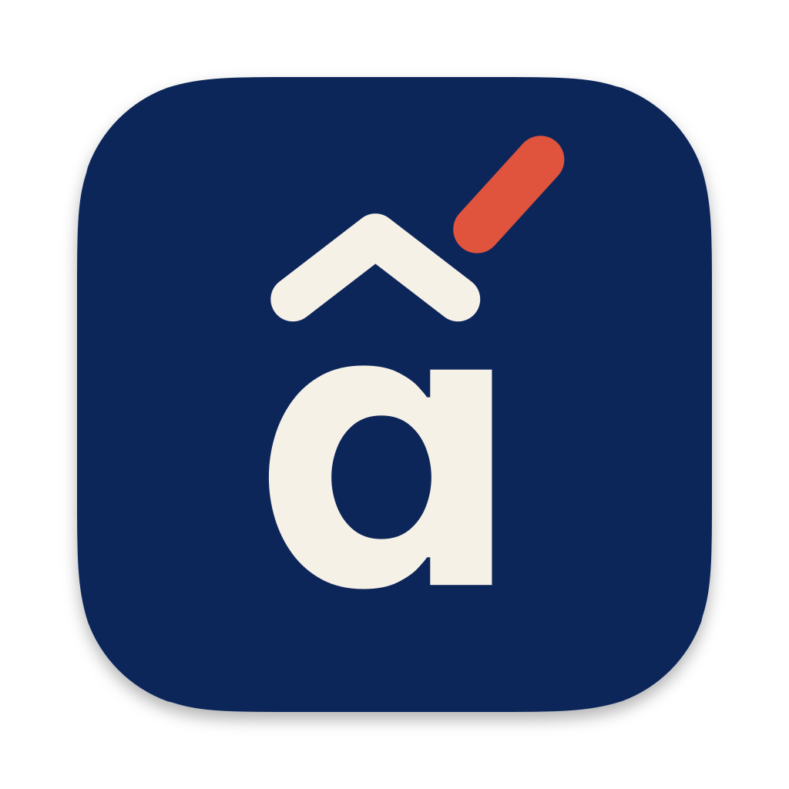
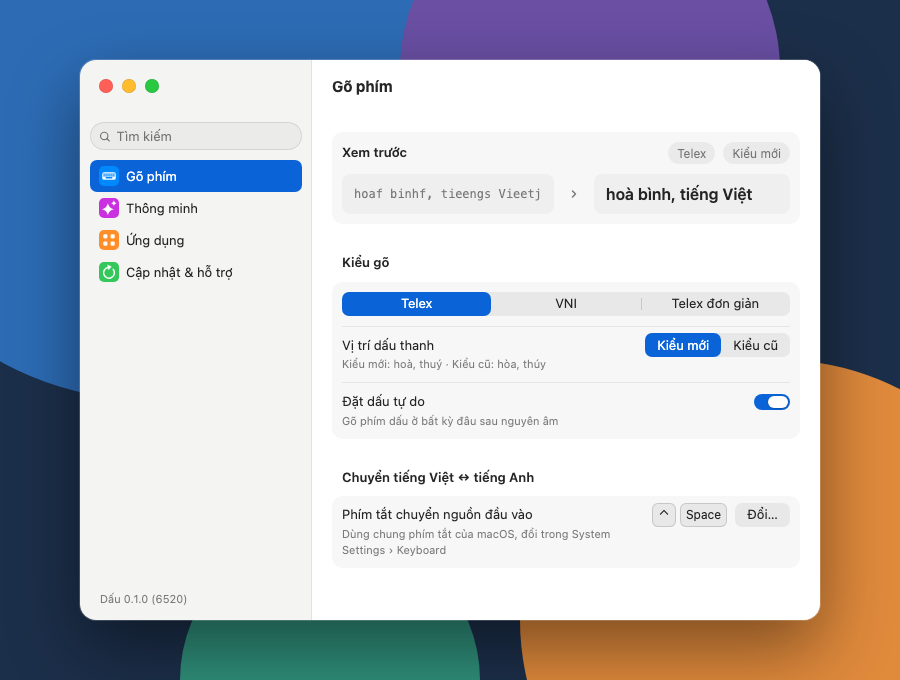

<p align="center">
  
</p>

<h1 align="center">Dấu</h1>

<p align="center"><strong>Bộ gõ tiếng Việt tự nhiên và chuẩn xác cho macOS.</strong></p>

<p align="center">Hoàn toàn miễn phí · Mã nguồn mở · Thiết kế riêng cho macOS</p>

<p align="center">
  <picture>
    <source media="(prefers-color-scheme: dark)" srcset="docs/canvas/SettingsDark.png">
    
  </picture>
</p>

---

### Một lựa chọn không cần thoả hiệp.

Người gõ tiếng Việt trên Mac thường phải chọn một trong hai đường. Đường thứ nhất là dùng bộ gõ có sẵn của macOS và chịu những chỗ nó gõ chưa đúng. Đường thứ hai là cài bộ gõ của bên thứ ba, cấp cho nó quyền can thiệp vào hệ thống, và chấp nhận việc nó xoá rồi gõ lại chữ bằng phím giả. Dấu được làm ra để người gõ không phải chọn như vậy: Dấu đặt dấu đúng chính tả, và Dấu là một nguồn đầu vào của macOS như mọi bàn phím của hệ thống.

### Chính tả chuẩn xác, dù kiểu mới hay kiểu cũ.

Dấu có ba kiểu gõ: Telex, VNI và Telex đơn giản. Dấu thanh luôn tự vào đúng nguyên âm theo chính tả, và bạn chọn được kiểu đặt dấu mới (hoà, thuý) hay kiểu cũ (hòa, thúy). Khi một từ đã sai chính tả, Dấu ngừng biến đổi từ đó chứ không đoán thay bạn.[^1] Trong một lượt gõ thử 60 câu tiếng Việt thông dụng trên Safari và Chrome, Dấu gõ đúng 677 trên 678 từ.[^2]

### Tự do bỏ dấu ở bất kỳ vị trí nào.

Bạn không cần gõ phím dấu ngay sau chữ cái mang dấu. Chuỗi `tuongw` ra "tương", chuỗi `hoaf` ra "hoà", và dấu thanh tự dời về đúng chỗ khi bạn gõ thêm nguyên âm.[^3]

### Bổ sung dấu linh hoạt cho từ đã gõ.

Bạn có thể đặt con trỏ ngay sau một từ đã gõ không dấu rồi bấm phím dấu để thêm dấu, ví dụ gõ thêm `ej` sau `viet` để được "việt". Khi bạn bấm ⌫, Dấu xoá chữ cuối và đặt lại dấu theo phần vần còn lại, ví dụ "hoà" thành "hò".[^4]

### Gõ liền mạch câu xen lẫn tiếng Anh.

Bạn có thể gõ một câu có xen tiếng Anh như "Sếp vừa gửi email về buổi meeting chiều nay" mà không phải chuyển bàn phím. Khi một từ kết thúc mà không phải âm tiết tiếng Việt hợp lệ, Dấu trả lại đúng các phím bạn đã gõ; Dấu làm việc này mà không dùng từ điển.[^5] Muốn giữ chữ gốc ngay giữa từ thì bạn gõ đúp phím dấu, ví dụ gõ `carr` để được "car".

### Hoạt động như bàn phím hệ thống.

Dấu là một nguồn đầu vào như mọi bàn phím khác trên Mac, không phải một ứng dụng chạy bên ngoài để chặn phím. Bạn chuyển giữa tiếng Việt và tiếng Anh bằng phím tắt và menu nguồn đầu vào của chính macOS, và không phải cấp quyền Trợ năng (Accessibility).[^6] Dấu thay chữ tại chỗ qua API nhập liệu của Apple, không giả lập phím Backspace.

### Những gì bạn gõ ở lại trên máy bạn.

Tiến trình bộ gõ chạy trong sandbox và không có quyền mạng. Dấu không có telemetry. Bản phát hành không ghi lại phím bạn bấm, lúc bạn gõ hay ứng dụng bạn đang dùng.[^7]

### Ít hơn, có chủ đích.

Dấu không làm lại việc macOS đã làm. Gõ tắt cả cụm từ đã có mục Thay thế văn bản (Text Replacement) của hệ thống, còn chuyển ngôn ngữ đã có phím tắt nguồn đầu vào. Dấu không có bảng mã cũ, không có quảng cáo và không có bản trả phí. Mọi quy tắc gõ và lý do của chúng ghi trong [`docs/Decisions.md`](docs/Decisions.md).

---

## Sắp ra mắt

Dấu chưa có bản cài để tải về. Dấu được làm cho macOS 14 trở lên (D1 (Nền tảng)), nhưng tới nay mới được kiểm trên macOS 27.2 và máy Apple silicon. Bản beta đầu tiên chỉ hứa những điều đã kiểm chứng.[^8] Các mốc phát triển ghi ở [`docs/Roadmap.md`](docs/Roadmap.md). Các ứng dụng đã thử và các giới hạn còn lại ghi ở [`docs/Compatibility.md`](docs/Compatibility.md).

## Dành cho nhà phát triển

Cách build, cách cài bộ gõ bằng Apple ID cá nhân và cách chạy các bộ test ghi ở [CONTRIBUTING.md](CONTRIBUTING.md). Riêng engine thì bạn chạy test được mà không cần Apple ID, bằng lệnh sau:

```sh
DEVELOPER_DIR=/Applications/Xcode.app/Contents/Developer swift test --package-path Packages/DauEngine
```

Các tài liệu sau giúp bạn tìm hiểu thêm về dự án:
- Kiến trúc, cấu trúc thư mục và luồng xử lý một phím được mô tả ở [`docs/Architecture.md`](docs/Architecture.md).
- Bản thiết kế của mọi màn hình nằm ở [`docs/canvas/README.md`](docs/canvas/README.md).
- Mục lục mọi tài liệu kỹ thuật và nghiên cứu nằm ở [`docs/README.md`](docs/README.md).
- Luật làm việc cho công cụ phát triển (Claude Code) nằm ở [CLAUDE.md](CLAUDE.md).

Để báo lỗi gõ, bạn mở một issue trên GitHub và ghi tên ứng dụng bị lỗi, kiểu gõ đang dùng (Telex hay VNI) và chuỗi phím đã gõ. Đừng dán thông tin hay nội dung riêng tư vào phần mô tả lỗi.

## Giấy phép

Dấu phát hành theo giấy phép GNU General Public License v3.0 (GPLv3). Toàn văn giấy phép nằm trong file [LICENSE](LICENSE).

[^1]: Theo các quyết định D15 (Cài đặt mặc định), D29 (Telex đơn giản) và D30 (Kiểm tra chính tả). Các test của engine kiểm hành vi này (`TonePlacementTests`, `VNITests`, `SpellingTests`), nằm ở [`Packages/DauEngine/Tests`](https://github.com/codefastlabs/dau/tree/main/Packages/DauEngine/Tests).
[^2]: Số này lấy từ một lượt đo ngày 09/11/2026 trên một máy chạy macOS 27.2, gõ Telex theo thứ tự chuẩn, mỗi phím cách nhau 30 ms. Từ sai duy nhất là "taxi" bị biến đổi thành "tãi" do đây là một âm tiết tiếng Việt hợp lệ (theo quyết định D4 (Từ nước ngoài)). Phương pháp chấm điểm không xét vị trí dấu thanh. Điều kiện đo và giới hạn của lượt đo ghi ở [`docs/research/CompetitorComparison.md`](https://github.com/codefastlabs/dau/blob/main/docs/research/CompetitorComparison.md), mục 1.
[^3]: Theo quyết định D28 (Đặt dấu tự do). Các test của engine kiểm hành vi này (`TonePlacementTests`), nằm ở [`Packages/DauEngine/Tests`](https://github.com/codefastlabs/dau/tree/main/Packages/DauEngine/Tests).
[^4]: Theo các quyết định D20 (Thêm dấu cho từ đã gõ) và D32 (Backspace). Tính năng thêm dấu cho từ đã gõ không áp dụng trên các ứng dụng đang bật chế độ gạch chân (theo quyết định D13 (Gạch chân là đường lui cuối cùng)), ví dụ như trình giả lập dòng lệnh Ghostty (theo quyết định D43 (Ô bỏ qua vùng thay chữ)).
[^5]: Theo quyết định D4 (Từ nước ngoài). Trong cùng lượt đo với chú thích [^2], ở các câu trộn lẫn tiếng Việt và tiếng Anh, Dấu xử lý chính xác 184 trên 188 từ. Với danh sách 105 từ tiếng Anh và từ khóa lập trình có chứa các phím dấu Telex, Dấu giữ nguyên được 88 từ, xử lý sai 7 từ và có 10 từ trùng với một âm tiết tiếng Việt hợp lệ. Trên các ứng dụng bật tính năng tự động sửa chính tả của macOS, hệ thống có thể tự điều chỉnh từ vừa gõ sau khi bấm dấu cách đối với mọi bộ gõ; người dùng có thể hoàn tác bằng tổ hợp phím ⌘Z. Nguồn số liệu nằm tại [`docs/research/CompetitorComparison.md`](https://github.com/codefastlabs/dau/blob/main/docs/research/CompetitorComparison.md), mục 1.
[^6]: Theo quyết định D2 (Chuyển Việt/Anh). Dấu đã được kiểm nghiệm thực tế và hoạt động bình thường mà không cần cấp quyền Trợ năng trên Chrome, VS Code và Terminal. Nguồn dữ liệu nằm tại [`docs/Decisions.md`](https://github.com/codefastlabs/dau/blob/main/docs/Decisions.md), nguyên tắc N4 (Không tự đổi cài đặt hệ thống).
[^7]: Theo các nguyên tắc N2 (Bộ gõ không có quyền mạng) và D8 (Không telemetry). Nguồn dữ liệu nằm tại [`docs/Decisions.md`](https://github.com/codefastlabs/dau/blob/main/docs/Decisions.md).
[^8]: Theo quyết định D1 (Nền tảng). Nguồn dữ liệu nằm tại [`docs/Decisions.md`](https://github.com/codefastlabs/dau/blob/main/docs/Decisions.md); các mốc phát triển đã thử nghiệm được ghi nhận tại [`docs/Roadmap.md`](https://github.com/codefastlabs/dau/blob/main/docs/Roadmap.md), mốc M7.
