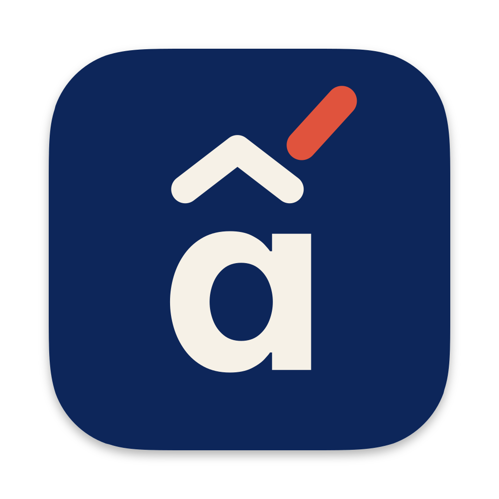
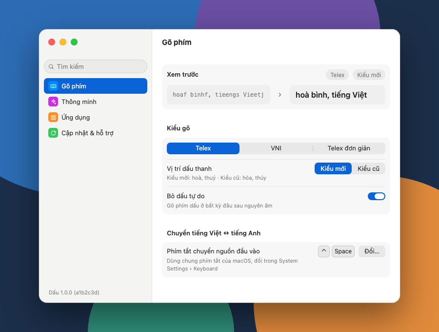

<p align="center">
  
</p>

<h1 align="center">Dấu</h1>

<p align="center"><strong>Gõ tiếng Việt trên Mac, dấu nào vào đúng chỗ nấy.</strong></p>

<p align="center">Miễn phí trọn vẹn · Mã nguồn mở · cho macOS</p>

<p align="center">
  <picture>
    <source media="(prefers-color-scheme: dark)" srcset="docs/canvas/SettingsDark.png">
    
  </picture>
</p>

---

### Gõ tiếng Việt, đúng từng dấu.

Telex, VNI hay Telex đơn giản. Dấu thanh tự vào đúng nguyên âm theo chính tả, kiểu mới (hoà, thuý) hay kiểu cũ (hòa, thúy) tuỳ bạn chọn. Từ đã sai chính tả thì Dấu thôi biến đổi, không đoán thay bạn.[^1] Gõ thử 60 câu tiếng Việt thông dụng trong Safari và Chrome, Dấu ra đúng 677 trên 678 từ.[^2]

### Dấu đặt ở đâu cũng được.

Phím dấu không cần đứng sát chữ. `tuongw` ra tương, `hoaf` ra hoà, và dấu tự dời về đúng chỗ khi bạn gõ thêm nguyên âm.[^3]

### Quên dấu? Quay lại thêm.

Đặt con trỏ sau một từ đã gõ không dấu, gõ phím dấu: `viet` thêm `ej` thành việt. Bấm ⌫ thì Dấu bỏ chữ cuối và đặt lại dấu theo vần còn lại: hoà thành hò.[^4]

### Câu có chữ tiếng Anh? Cứ gõ.

"Sếp vừa gửi email về buổi meeting chiều nay." Gõ một mạch, không phải chuyển bàn phím: từ nào không thành tiếng Việt, Dấu trả lại đúng các phím bạn đã gõ, không cần từ điển.[^5] Muốn giữ chữ gốc ngay giữa từ thì gõ đúp phím dấu: `carr` ra car.

### Là một phần của macOS.

Dấu là một nguồn đầu vào như mọi bàn phím khác trên Mac. Chuyển Việt/Anh bằng chính phím tắt và menu nguồn đầu vào của macOS, không xin quyền Trợ năng.[^6] Chữ được thay ngay tại chỗ qua API nhập liệu của Apple, không giả lập phím Backspace.

### Những gì bạn gõ ở lại trên máy bạn.

Bộ gõ không có quyền kết nối mạng. Không telemetry. Bản phát hành không ghi lại phím nào bạn gõ, kể cả thời điểm gõ hay ứng dụng đang gõ.[^7]

### Ít hơn, có chủ đích.

Việc macOS đã làm tốt, Dấu không làm lại: gõ tắt văn bản đã có Thay thế văn bản, chuyển Việt/Anh đã có phím tắt nguồn đầu vào. Không bảng mã cũ, không quảng cáo, không bản trả phí. Mọi quy tắc gõ đều được viết ra, kèm lý do, trong [`docs/DECISIONS.md`](docs/DECISIONS.md).

---

## Sắp ra mắt

Dấu chưa có bản tải về. Yêu cầu: macOS 14 trở lên (D1 (Nền tảng)); tới nay mới thử trên macOS 27.2.[^8] Các mốc tới khi phát hành: [`docs/ROADMAP.md`](docs/ROADMAP.md). Những ứng dụng đã thử và giới hạn còn lại: [`docs/COMPATIBILITY.md`](docs/COMPATIBILITY.md).

## Dành cho nhà phát triển

Build, cài bằng Apple ID của bạn và chạy mọi bộ test: [CONTRIBUTING.md](CONTRIBUTING.md). Test engine không cần Apple ID:

```sh
swift test --package-path Packages/DauEngine
```

Kiến trúc, cấu trúc thư mục và luồng một phím: [`docs/ARCHITECTURE.md`](docs/ARCHITECTURE.md). Thiết kế mọi màn hình: [`docs/canvas/README.md`](docs/canvas/README.md). Mục lục tài liệu: [`docs/README.md`](docs/README.md). Làm việc cùng Claude Code: [CLAUDE.md](CLAUDE.md).

**Báo lỗi gõ:** mở issue, kèm tên ứng dụng, Telex hay VNI, và chuỗi phím đã gõ. Đừng dán nội dung riêng tư.

## Giấy phép

GPLv3. Xem [LICENSE](LICENSE).

[^1]: D15 (Cài đặt mặc định), D29 (Telex đơn giản), D30 (Kiểm tra chính tả). Kiểm bằng test của engine (`TonePlacementTests`, `VNITests`, `SpellingTests`): [`Packages/DauEngine/Tests`](https://github.com/codefastlabs/dau/tree/main/Packages/DauEngine/Tests).
[^2]: Một lượt đo ngày 09/11/2026, một máy, macOS 27.2: Telex gõ theo thứ tự chuẩn, phím cách nhau 30 ms. Từ sai duy nhất là "taxi" ra "tãi", vì đó là âm tiết tiếng Việt hợp lệ (D4 (Từ nước ngoài)). Cách chấm không xét vị trí dấu thanh. Điều kiện và giới hạn: [`docs/research/COMPETITOR-COMPARISON.md`](https://github.com/codefastlabs/dau/blob/main/docs/research/COMPETITOR-COMPARISON.md), mục 1.
[^3]: D28 (Bỏ dấu tự do). Kiểm bằng test của engine (`TonePlacementTests`): [`Packages/DauEngine/Tests`](https://github.com/codefastlabs/dau/tree/main/Packages/DauEngine/Tests).
[^4]: D20 (Thêm dấu cho từ đã gõ), D32 (Backspace). Thêm dấu cho từ đã gõ không chạy ở ứng dụng đang dùng gạch chân (D13 (Gạch chân là đường lui cuối cùng)) và ở ô không cho đọc chữ, như terminal Ghostty (D43 (Ô bỏ qua vùng thay chữ)).
[^5]: D4. Cùng lượt đo với chú thích 2: trong câu trộn Việt–Anh, Dấu ra đúng 184/188 từ; với 105 từ tiếng Anh và từ trong mã có chứa phím dấu Telex, Dấu giữ nguyên 88 từ, 7 từ ra sai, 10 từ trùng với một từ tiếng Việt. Ở ứng dụng bật tự sửa chính tả, macOS có thể sửa từ vừa gõ sau dấu cách, với mọi bộ gõ; hoàn tác bằng ⌘Z. Nguồn: [`docs/research/COMPETITOR-COMPARISON.md`](https://github.com/codefastlabs/dau/blob/main/docs/research/COMPETITOR-COMPARISON.md), mục 1.
[^6]: D2 (Chuyển Việt/Anh). Đã thử không cần quyền Trợ năng trong Chrome, VS Code và Terminal. Nguồn: [`docs/DECISIONS.md`](https://github.com/codefastlabs/dau/blob/main/docs/DECISIONS.md), N4 (Không tự đổi cài đặt hệ thống).
[^7]: N2 (Bộ gõ không có quyền mạng), D8 (Không telemetry). Nguồn: [`docs/DECISIONS.md`](https://github.com/codefastlabs/dau/blob/main/docs/DECISIONS.md).
[^8]: D1. Nguồn: [`docs/DECISIONS.md`](https://github.com/codefastlabs/dau/blob/main/docs/DECISIONS.md); các mốc đã thử: [`docs/ROADMAP.md`](https://github.com/codefastlabs/dau/blob/main/docs/ROADMAP.md), M7.
