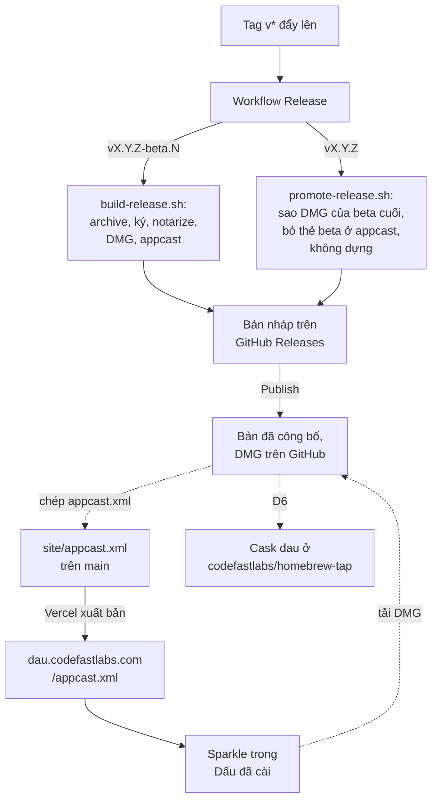
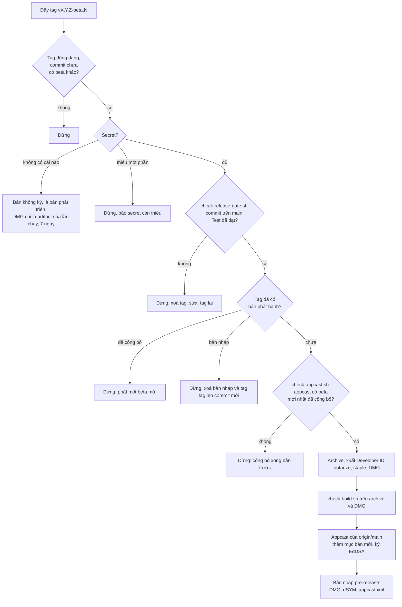
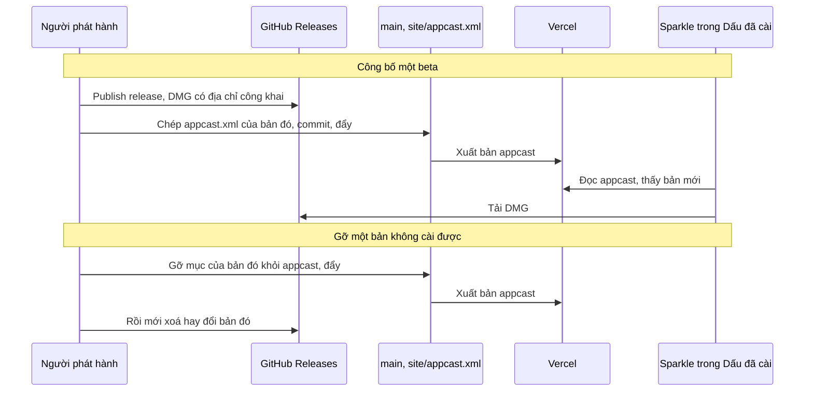

# Phát hành

Tài liệu này tả cách một bản Dấu ra đời, từ tag git tới DMG, bản cập nhật Sparkle và Homebrew. Các quyết định liên quan là D6 (Phát hành), D7 (Cập nhật và loại bản dựng) và D25 (Nhận diện). Kế hoạch mốc nằm ở [`docs/Progress.md`](Progress.md), mục "Kế hoạch M7".



Phiên chính và subagent không cầm khoá. Chứng chỉ, khoá App Store Connect và khoá EdDSA chỉ nằm ở máy người dùng và trong secret của GitHub. Mọi thứ trong repo chỉ là mã, mẫu cấu hình và tên secret.

## Kịch bản phát hành

Dấu đi theo một vòng: phát nhiều bản beta để người dùng thử sớm và góp ý, rồi chốt beta cuối thành bản chính thức, rồi lại phát beta cho phiên bản sau. Vòng này không có nhịp cố định. Bản mới ra tuỳ theo khối lượng việc, độ hoàn thiện của tính năng, các app cần hỗ trợ thêm và các bản macOS mới. Kênh và từ ngữ theo D7 (Cập nhật và loại bản dựng) và [`docs/Glossary.md`](Glossary.md).

| Giai đoạn | Tag | Ai nhận |
|---|---|---|
| 1. Dùng thử sớm, chưa có bản chính thức | `v0.1.0-beta.1`, `beta.2`… | Mọi người đều nhận: kênh mặc định là Beta. Lựa chọn Chính thức hiện nhưng bị tắt. Cask và nút "Tải về" trỏ vào beta mới nhất (D6). |
| 2. Chốt bản chính thức | `v0.1.0` trên commit của beta cuối | Bỏ thẻ kênh `beta` khỏi mục của beta cuối để thành bản chính thức. Lựa chọn Chính thức bật lên. Người đã cài giữ kênh của mình. Người cài từ lúc này có kênh mặc định là Chính thức. Cask cùng nút "Tải về" trỏ vào bản chính thức. |
| 3. Phát triển tiếp, dùng thử sớm | `v0.2.0-beta.1`… | Chỉ kênh Beta nhận. Kênh Chính thức giữ `0.1.0`. |
| 4. Chốt bản kế tiếp | `v0.2.0` trên commit của beta cuối | Kênh Chính thức nhận bản này. Kênh Beta đã có đúng tệp đó nên không nhận gì. Vòng quay lại giai đoạn 3. |

Các kịch bản sau có thể chen vào vòng đó:

| Kịch bản | Cách làm |
|---|---|
| Beta bị lỗi | Phát ngay một beta sửa (mục "Khi một bản bị hỏng"). Chỉ kênh Beta bị ảnh hưởng. |
| Bản cập nhật không cài được | Gỡ mục của bản đó khỏi appcast trước, rồi mới đụng tới GitHub (mục "Thứ tự công bố và gỡ"). |
| Bản chính thức bị lỗi khi `main` đã có việc dở cho phiên bản sau | Sửa trên một nhánh tách từ commit của bản chính thức, phát beta `0.1.1-beta.1` trên nhánh đó, rồi quảng bá thành `0.1.1`. Số build lấy trong khoảng trống sau bản chính thức (đoạn "Số build"). Bản sửa cũng được đưa vào `main`. Hiện chưa làm được việc này, vì `check-release-gate.sh` chỉ nhận commit nằm trong `origin/main` và workflow Test chỉ chạy trên `main` (kế hoạch nằm ở [`docs/Roadmap.md`](Roadmap.md)). |
| Người dùng đổi kênh | Người chuyển sang Beta nhận beta mới nhất ở lần kiểm tra sau. Người chuyển sang Chính thức giữ bản đang chạy cho tới khi có bản chính thức có số build cao hơn (D7). |
| Bản macOS mới | Thử Dấu trên bản beta của macOS, phát beta sửa và chốt bản chính thức trước ngày macOS ra bản chính thức. Chỉ ghi đã kiểm trên bản macOS nào sau khi đã đo (D1 (Nền tảng)). |
| Nâng bản macOS tối thiểu | Mục appcast phải mang `sparkle:minimumSystemVersion`, để máy chạy macOS cũ dừng ở bản cuối còn chạy được. Chưa kiểm xem `generate_appcast` có tự ghi khoá này không ([`docs/Roadmap.md`](Roadmap.md)). |
| Thêm app vào danh sách tương thích | Danh sách đi kèm app (D7), nên thay đổi này đi qua beta rồi bản chính thức như mọi thay đổi khác. |
| Quay về bản trước | Việc này theo D19 (Quay về bản trước) và để sau beta đầu tiên. |
| Tên miền, chứng chỉ, khoá hết hạn | Xem mục "Hết hạn và gia hạn". |

## Thành phần

| Thành phần | Ở đâu |
|---|---|
| Script dựng một bản beta (archive, xuất Developer ID, notarize, staple, DMG, appcast) | `scripts/release/build-release.sh` |
| Script quảng bá beta cuối thành bản chính thức (sao tài sản, bỏ thẻ kênh beta khỏi appcast, không dựng) | `scripts/release/promote-release.sh` |
| Kiểm một bản build (biểu tượng, ký hiệu, khoá Sparkle, bộ gõ, chữ ký) | `scripts/release/check-build.sh` |
| Kiểm điều kiện của một tag: commit nằm trong `origin/main`, workflow Test đã đạt (dùng chung cho dựng và quảng bá) | `scripts/release/check-release-gate.sh` |
| Kiểm appcast: nền có mục của beta mới nhất đã công bố; mục beta mới mang thẻ `beta`; appcast quảng bá chỉ khác bản trước ở thẻ đó | `scripts/release/check-appcast.sh` |
| Tự kiểm offline phần đọc và sửa appcast (không mạng, không khoá), dùng thư viện `scripts/lib/appcast.sh` | `scripts/release/test-appcast.sh` |
| Sắp xếp cửa sổ DMG bằng Finder (chỉ CI) | `scripts/release/layout-dmg.sh` |
| Test ở mỗi lần đẩy mã | `.github/workflows/test.yml` |
| Tag `v*`: beta dựng bản nháp, bản chính thức quảng bá beta cuối, trên GitHub Releases | `.github/workflows/release.yml` |
| Appcast, thư mục gốc của project Vercel | `site/appcast.xml` |

Cách gọi và tuỳ chọn của từng script nằm ở đầu script đó.

## Việc của người dùng (làm một lần)

1. **Apple Developer Program** (99 USD/năm). Người dùng đăng ký dưới dạng tổ chức nếu codefastlabs là pháp nhân (cần mã D-U-N-S), để Gatekeeper hiện tên tổ chức (D7). Sau đó ghi lại **Team ID** (developer.apple.com › Account › Membership details).
2. **Chứng chỉ Developer ID Application.** Trong Xcode, vào Settings › Accounts, chọn Team, chọn Manage Certificates, bấm "+" rồi chọn Developer ID Application. Sau đó trong Keychain Access, vào login › My Certificates, chuột phải vào chứng chỉ vừa tạo, chọn Export…, chọn định dạng `.p12` và đặt mật khẩu. File `.p12` phải để ngoài repo.
3. **Khoá App Store Connect API cho notarize.** Trong App Store Connect, vào Users and Access › Integrations › App Store Connect API › Team Keys và tạo một khoá (vai trò Developer là đủ). Tải file `.p8` về. File này chỉ tải được một lần. Sau đó ghi lại **Key ID** và **Issuer ID** (hiện ở đầu trang).
4. **Khoá EdDSA của Sparkle.** Công cụ tạo khoá nằm trong gói Sparkle mà Xcode đã tải. Chạy các lệnh sau từ gốc repo:

   ```sh
   xcodegen generate
   xcodebuild -resolvePackageDependencies -project Dau.xcodeproj -scheme Dau -derivedDataPath build/DerivedData-keys
   B=build/DerivedData-keys/SourcePackages/artifacts/sparkle/Sparkle/bin
   $B/generate_keys                      # tạo khoá, cất khoá riêng vào Keychain đăng nhập, in KHOÁ CÔNG KHAI
   $B/generate_keys -x ~/dau-sparkle.key # xuất khoá riêng ra file (ngoài repo)
   ```

   Khoá công khai được in ra (một chuỗi base64 ngắn) là `DAU_SPARKLE_PUBLIC_KEY`. Nội dung file xuất ra là `DAU_SPARKLE_PRIVATE_KEY`. Xong việc, hãy cất một bản sao ở nơi an toàn (trình quản lý mật khẩu), rồi xoá file xuất. Nếu mất khoá riêng, mọi bản đã cài sẽ không cập nhật được nữa, vì chúng chỉ tin chữ ký của đúng khoá này. Sau đó dọn `build/DerivedData-keys`.
5. **Nạp secret vào GitHub** (repo › Settings › Secrets and variables › Actions hoặc `gh secret set TÊN`). Bảng dưới ghi tên chính xác mà workflow dùng:

   | Secret | Giá trị |
   |---|---|
   | `DAU_TEAM_ID` | Team ID (bước 1) |
   | `DAU_DEVELOPER_ID_P12` | file `.p12` mã base64: `base64 -i file.p12 \| pbcopy` |
   | `DAU_DEVELOPER_ID_P12_PASSWORD` | mật khẩu của `.p12` |
   | `DAU_NOTARY_KEY` | nội dung file `.p8` (cả dòng BEGIN/END) |
   | `DAU_NOTARY_KEY_ID` | Key ID |
   | `DAU_NOTARY_ISSUER_ID` | Issuer ID |
   | `DAU_SPARKLE_PUBLIC_KEY` | khoá công khai (bước 4) |
   | `DAU_SPARKLE_PRIVATE_KEY` | khoá riêng (bước 4) |

   Nếu cấu hình còn dở dang (chỉ có một phần), script dừng và báo tên các secret còn thiếu, thay vì âm thầm ra một bản không ký. Nếu chưa có secret nào, script chạy ở chế độ không ký (xem bên dưới).
6. **Vercel.** Nối repo `codefastlabs/dau` với project của `dau.codefastlabs.com`, đặt Root Directory là `site` và không có bước build. Tới M8, thư mục này chỉ có `appcast.xml`; hãy kiểm rằng `https://dau.codefastlabs.com/appcast.xml` trả về file đó.
7. **Nền DMG.** Ảnh nền là `Resources/Brand/DmgBackground.png` (640×400 pt, theo artboard "Cửa sổ ảnh đĩa DMG" trong `docs/canvas/src/DmgWindow.dc.html`) và có thể thêm `DmgBackground@2x.png` (1280×800, cho màn hình Retina). Script ghép hai file thành một TIFF. Nếu thiếu `DmgBackground.png` thì DMG không có nền.

## Phát hành một tag

Có hai đường tuỳ theo tag. Mọi tag đều bắt đầu bằng `v` và theo một trong các dạng dưới đây; dạng khác bị từ chối.

| Tag | Số hiển thị (`CFBundleShortVersionString`) | Workflow làm gì |
|---|---|---|
| `v0.1.0-beta.1` | 0.1.0 | Dựng một bản beta (đường beta, bên dưới). |
| `v0.1.0-beta.2` | 0.1.0 | Dựng một bản beta, trên commit mới. |
| `v0.1.0` | 0.1.0 (cùng tệp với beta cuối) | Quảng bá beta cuối và không dựng (đường chính thức, bên dưới). |

Số hiển thị luôn là ba số nguyên `X.Y.Z`. Chữ "beta N" chỉ nằm ngoài tệp nhị phân, tức là ở tên tag và ở tiêu đề bản phát hành trên GitHub (D7). Bản phát triển dựng bằng `scripts/dev/install-app.sh` mang số `X.Y.Z` của tag `v*` gần nhất trên HEAD; nếu không có tag thì dùng số trong `project.yml`. Bản build bằng Xcode cũng giữ số trong `project.yml`.

Sơ đồ dưới tả vòng đời của một bản, từ tag tới lúc thôi phát:


**Điều kiện chung** (`scripts/release/check-release-gate.sh`, chạy được trên máy): workflow chỉ dựng bản ký hay quảng bá khi commit có tag nằm trong `origin/main` và workflow Test đã đạt trên đúng commit đó. Nếu thiếu một trong hai điều kiện, workflow dừng và báo lý do. Nếu đã tag lên một commit chưa lên `main` hay chưa xanh, hãy xoá tag, sửa, rồi tag lại.

### Đường beta

Sơ đồ dưới liệt kê các điểm kiểm trước khi dựng, theo đúng thứ tự mà `scripts/release/build-release.sh` chạy chúng:



1. Bảo đảm `main` đang xanh (workflow Test) và mọi thứ của bản này đã được commit.
2. Chạy bài tải nặng của D42 (Ngưỡng hiệu năng) trên commit sẽ được tag: `scripts/selftest/load/heavy.sh` với bộ gõ bản Debug. Đây là lượt chạy chiếm màn hình, nên phiên chính chạy nó (`CLAUDE.md`, mục "Điều phối"). Chữ gõ ra phải đúng ở mọi ô và p99 cùng bộ nhớ phải nằm trong ngưỡng. Nếu không đạt thì không tag cho tới khi rõ nguyên nhân. Ghi số đo vào nhật ký `docs/Progress.md`; trang tải về lấy số của mục "Đo được" từ đó.
3. Tag và đẩy tag. Với hai bản thử ở bước 2 của kế hoạch M7, việc này công bố chúng lên appcast, nên cần người dùng đồng ý trước khi đẩy tag.

   ```sh
   git tag v0.1.0-beta.1
   git push origin v0.1.0-beta.1
   ```

   Mỗi beta cần một commit mới. Script từ chối tag beta đặt lên commit đã có tag beta khác, vì cùng commit thì cùng số build.

   **Tag đã công bố không bao giờ được dựng lại:** bản ký từ chối một tag đã có bản phát hành không phải bản nháp. Nếu CI hỏng trước khi công bố, hãy xoá bản nháp (và tag) trên GitHub rồi tag lên một commit mới. Tag còn bản nháp cũng bị từ chối, để không dựng đè lên bản nháp đó.
4. Workflow Release dựng bản ký, rồi tạo một **bản nháp** pre-release trên GitHub Releases (tiêu đề "Dấu 0.1.0 beta 1") kèm DMG, dSYM và `appcast.xml`. Appcast này là appcast của `origin/main` cộng mục của bản mới; nó không lấy file ở commit có tag, vì mục của bản trước chỉ đưa vào file trên `main` ở bước Công bố. Bản ký từ chối dựng nếu appcast đó thiếu beta mới nhất đã công bố trên GitHub (`check-appcast.sh`), nên phải công bố xong bản trước (bước 5) rồi mới tag bản sau. Ở bước này chưa công bố gì, nên người dùng chưa thấy gì. Nếu thiếu secret, workflow dựng bản không ký (xem bên dưới) và chỉ lưu DMG thành artifact của lần chạy (7 ngày), không tạo bản nháp.
5. Kiểm bản nháp. Log của workflow in từng bước đã làm hay bị bỏ qua, kèm `summary.txt`. Hãy thử mở DMG đã tải về.
6. **Công bố.** Người dùng đồng ý một lần cho beta đầu tiên, theo bước 4 của kế hoạch M7. Bấm Publish release trên GitHub, rồi chép `appcast.xml` từ tài sản của bản đó vào `site/appcast.xml`, commit và đẩy lên `main` để Vercel xuất bản. Phải làm theo đúng thứ tự này, vì nếu appcast lên trước thì Sparkle sẽ trỏ vào một địa chỉ DMG chưa có. Cask Homebrew nằm ở `codefastlabs/homebrew-tap` và theo D6 (Phát hành).

### Đường chính thức (quảng bá beta cuối)

Bản chính thức là tệp nhị phân của bản beta cuối, giữ nguyên và không dựng lại (như bản ứng viên của Apple): cùng DMG, cùng chữ ký, cùng vé notarize và cùng `CFBundleVersion`. Nếu muốn sửa gì sau beta cuối, hãy phát thêm một beta, chứ không sửa rồi tag bản chính thức.

1. Beta cuối đã được công bố (bước 5 ở trên), nên item của nó đã nằm trong `site/appcast.xml` cho mọi người. Vì vậy bản chính thức **không thêm item** vào appcast (cùng `sparkle:version`), mà chỉ bỏ thẻ kênh `beta` khỏi item đó (D7). Mọi item beta mang `<sparkle:channel>beta</sparkle:channel>`; `build-release.sh` gắn thẻ này bằng tuỳ chọn `--channel beta` của `generate_appcast`. Item không có thẻ là bản chính thức. Kênh nào cũng thấy nó. Chữ ký EdDSA (`sparkle:edSignature` trên `<enclosure>`) phủ DMG chứ không phủ thẻ kênh, nên bỏ thẻ thì không cần ký lại.
2. Tag **đúng commit của tag beta cuối** rồi đẩy tag:

   ```sh
   git tag v0.1.0 v0.1.0-beta.2
   git push origin v0.1.0
   ```

   Workflow Release chạy `scripts/release/promote-release.sh`. Script làm các việc sau:
   - Script này tìm tag `v0.1.0-beta.N` cùng commit (lấy N lớn nhất), tải DMG và dSYM của bản phát hành đó và đổi tên chúng thành `Dau-0.1.0.dmg` và `Dau-0.1.0.dSYMs.zip`. Đổi tên không làm đổi chữ ký hay vé notarize, vì cả hai nằm trên nội dung DMG; script kiểm lại bằng `codesign`, `stapler validate`, `spctl` và số hiển thị của Dau.app trong DMG.
   - Script này lấy `site/appcast.xml` của `origin/main`, bỏ đúng thẻ `beta` khỏi item của beta cuối (không đổi byte nào khác và không thêm item), rồi kiểm bằng `check-appcast.sh --promoted`.
   - Script này tạo một **bản nháp** không pre-release kèm DMG, dSYM và `appcast.xml` đã quảng bá, như đường beta.

   Script từ chối khi tag không trỏ vào commit của tag beta nào, khi beta chưa được công bố, khi item của beta không có trong appcast của `origin/main` hay đã không còn thẻ `beta` hoặc khi đã có bản phát hành cùng tag. Có thể chạy thử trên máy mà không tạo gì bằng `scripts/release/promote-release.sh --tag v0.1.0 --dry-run`.
3. **Công bố.** Bấm Publish release trên GitHub, rồi chép `appcast.xml` từ tài sản của bản đó vào `site/appcast.xml`, commit và đẩy lên `main` (cùng thứ tự và cách làm như bước 5 của đường beta). Cask Homebrew nằm ở `codefastlabs/homebrew-tap` và theo D6 (Phát hành).

**Số build.** `CFBundleVersion` mặc định bằng mười lần số commit của HEAD (`git rev-list --count`), nên nó tăng theo lịch sử. Mỗi bản dựng có một số. Số này, ghi trong ngoặc sau số hiển thị (D25), phân biệt các beta của cùng một phiên bản (vì chúng cùng số hiển thị). Bản chính thức không có số riêng mà mang số của beta cuối. `build-release.sh` (bản ký) từ chối một số build đã có ở `sparkle:version` của bất kỳ item nào trong appcast của `origin/main`, báo lỗi và bảo dùng `--build-number`. Cờ `--build-number` đặt một số khác khi cần. Bản sửa gấp trên nhánh phải dùng cờ này. Lý do là nhánh tách từ commit thứ N có số mặc định 10(N+1), trùng với beta có thể đã phát từ commit thứ N+1 trên `main`, mà Sparkle coi hai bản cùng số là một. Bản sửa gấp lấy số trong khoảng trống giữa hai mốc (10N+1…10N+9). Cũng vì vậy, `main` đã push không bao giờ bị viết lại (force push, rebase): lịch sử ngắn lại thì số build sẽ lùi.

### Thứ tự công bố và gỡ

Sơ đồ dưới tả luật thứ tự ở bước 5 của đường beta và ở bước 3 của mục "Khi một bản bị hỏng": appcast chỉ trỏ vào DMG đã có địa chỉ công khai trên GitHub.



## Khi một bản bị hỏng

Có hai kênh (D7): beta chỉ tới kênh Beta, còn bản chính thức tới cả hai kênh.

1. **Phát ngay một beta sửa** (theo đường beta, trên commit mới). Beta sửa có số build cao hơn, nên Sparkle đẩy nó tới kênh Beta, kể cả tới người đã cài bản hỏng. Nếu bản hỏng là bản chính thức thì quảng bá beta sửa đó thành bản chính thức mới. Nếu `main` đã có việc dở thì làm theo kịch bản "Bản chính thức bị lỗi" ở mục "Kịch bản phát hành".
2. **Không xoá bản hỏng khỏi GitHub**, vì mục appcast của nó trỏ vào DMG ở đó và máy đã tải appcast cũ vẫn cần địa chỉ ấy.
3. **Chỉ gỡ mục của bản hỏng khỏi appcast khi bản đó không cài được** (người dùng không cập nhật qua nó được). Hãy gỡ khỏi `site/appcast.xml` trước, đợi Vercel xuất bản, rồi mới xoá hay đổi gì trên GitHub. Nếu làm ngược lại, appcast sẽ trỏ vào một địa chỉ không còn.
4. Quay về bản trước (D19) để sau beta đầu tiên.

## Hết hạn và gia hạn

Dấu đã cài chạy không cần mạng (N2, D8) và không có bản quyền hay tài khoản (D6), nên không có hạn nào làm bộ gõ ngừng chạy. Những thứ hết hạn chỉ chặn việc phát bản mới hay việc nhận cập nhật. Riêng một chứng chỉ bị **thu hồi** thì làm bản đã cài không mở được nữa.

| Thứ có hạn | Hết hạn hay mất thì | Bản đã cài | Cách tránh, cách cứu |
|---|---|---|---|
| Tên miền `codefastlabs.com` | Sparkle không đọc được appcast (`SUFeedURL` cố định trong app). | Bản đã cài vẫn chạy nhưng không nhận cập nhật. | Bật tự gia hạn ở nhà đăng ký. Nếu đã mất tên miền thì không có đường nào báo bản mới cho máy đã cài: phải phát bản mới với địa chỉ appcast mới qua GitHub Releases và Homebrew. Người dùng cài tay một lần. |
| Chứng chỉ HTTPS của `dau.codefastlabs.com` | Hậu quả như dòng trên. | Bản đã cài vẫn chạy nhưng không nhận cập nhật. | Vercel tự cấp và gia hạn chứng chỉ khi tên miền còn trỏ đúng. Kiểm bằng `curl -sI https://dau.codefastlabs.com/appcast.xml`. |
| Apple Developer Program (gia hạn hằng năm) | Không lấy được chứng chỉ Developer ID mới, nên không ký hay notarize được bản mới. | Theo Apple, bản đã cài vẫn chạy[^devid]. | Gia hạn trước hạn. Nếu đã quá hạn thì gia hạn lại, rồi ký bản sau như thường. |
| Chứng chỉ Developer ID Application (hạn ghi trên chứng chỉ trong Keychain Access) | Không ký được bản mới. | Bản đã cài vẫn chạy, vì Gatekeeper xét chứng chỉ còn hạn vào lúc ký[^devid]. Bản ký có dấu thời gian (`--timestamp` trong `build-release.sh`) và không dùng provisioning profile (`project.yml`), nên không có profile nào hết hạn mỗi lần mở. | Tạo chứng chỉ mới, rồi thay secret `DAU_DEVELOPER_ID_P12` và `DAU_DEVELOPER_ID_P12_PASSWORD`. |
| Chứng chỉ Developer ID **bị thu hồi** (khoá lộ, Apple thu hồi) | Mọi bản ký bằng chứng chỉ đó không cài được và không mở được nữa[^devid]. | Bản đã cài **không mở được**. | Giữ `.p12` ngoài repo, chỉ trong secret của GitHub và trình quản lý mật khẩu. Nếu đã bị thu hồi thì tạo chứng chỉ mới và phát ngay một bản mới; người dùng tải lại DMG hay chạy `brew reinstall`, vì bản cũ không tự cập nhật được nữa. |
| Khoá EdDSA của Sparkle (không có hạn) | Nếu mất khoá riêng, bản đã cài vẫn chỉ tin chữ ký của đúng khoá này. | Bản đã cài vẫn chạy nhưng kẹt ở bản đó. | Cất bản sao trong trình quản lý mật khẩu ("Việc của người dùng", bước 4). Nếu đã mất thì xử lý như mất tên miền: người dùng cài tay bản mới một lần. |
| Khoá App Store Connect API (notarize), bị thu hồi hay mất | Không notarize được. | Bản đã cài không bị ảnh hưởng. | Tạo khoá mới, rồi thay `DAU_NOTARY_KEY`, `DAU_NOTARY_KEY_ID`, `DAU_NOTARY_ISSUER_ID`. |

[^devid]: Apple, Developer ID: https://developer.apple.com/support/developer-id/

## Chế độ không ký

Khi không có secret nào (hoặc khi dùng `--unsigned`), script vẫn chạy trọn từ archive tới DMG và báo bước nào bị bỏ qua: xuất Developer ID, notarize, staple, ký DMG, ký bản cập nhật và appcast. Bản này dựng như bản phát triển (D7, D25) và dùng để kiểm quy trình, không phát cho người dùng:

- `DAU_OFFICIAL=NO`, nên bản này dùng biểu tượng bản phát triển và không có `SUFeedURL`, `SUPublicEDKey`; vì vậy Sparkle không khởi động.
- App ký tạm (ad hoc) và không có Team ID, nên App Group bị từ chối (D24).
- DMG có tên `Dau-<phiên bản>-dev-unsigned.dmg` (nếu không có tag thì là `Dau-dev-unsigned.dmg`) và không có appcast.

Lệnh dưới chạy trên máy phát triển và không cần chứng chỉ; nó mất khoảng một phút và ghi vào `build/release/`:

```sh
scripts/release/build-release.sh --tag v0.1.0-beta.1 --unsigned
```

Nếu không có cờ `--layout` thì script không mở Finder. Khi đó DMG có Dau.app và liên kết Applications, nhưng cửa sổ dùng bố cục mặc định và không có nền.

## Bố cục cửa sổ DMG

Bố cục (kích thước cửa sổ, vị trí biểu tượng, nền) nằm trong `.DS_Store` của ảnh đĩa và do Finder ghi; macOS không có API công khai nào khác để làm việc này. `--layout` gọi `scripts/release/layout-dmg.sh`, script này dùng AppleScript điều khiển Finder trong vài giây và hiện một cửa sổ Finder. Vì vậy nó chỉ chạy trên CI (workflow Release đã bật cờ này) hoặc trên máy như một lượt chạy chiếm màn hình, do phiên chính chạy theo chế độ quyền của Claude Code ([`CLAUDE.md`](../CLAUDE.md), mục "Điều phối"). Nếu bước này lỗi, script cảnh báo và vẫn ra DMG không có bố cục; hãy đọc dòng "Bố cục cửa sổ DMG" ở `summary.txt`.

## Kiểm bản build

`scripts/release/check-build.sh` chạy trong script phát hành, trên cả bản trong archive lẫn bản trong DMG đã mở.
- Với bản chính thức (`--signed`), `CFBundleIconName` của Dấu.app và của bộ gõ phải là `AppIcon` (D25). App chủ phải có `SUFeedURL` cùng `SUPublicEDKey`.
- Với bản không ký, biểu tượng phải là `AppIconDev`. App không có hai khoá đó.
- Ở cả hai loại, hai binary phải là universal và đã lược ký hiệu cục bộ (`nm`), dSYM của cả hai phải có trong archive, bộ gõ không có khoá `SU…`, `SUEnableSystemProfiling` là false (D8) và bộ gõ không link Sparkle và không có quyền mạng (N2).
- Bản ký còn kiểm bằng `codesign`, `spctl` và `stapler validate`.

## Còn phải thấy chạy thật

Phần ký, notarize, staple, `layout-dmg.sh` và `generate_appcast` ký thật cần tài khoản hoặc Finder, nên chưa chạy ở máy phát triển; chế độ không ký thì đã chạy trọn tới DMG. Lần đầu thấy các phần đó chạy sẽ là bước 2 của kế hoạch M7 (hai tag thử sau bước 0), rồi sửa script theo log của lần đó.

Đường quảng bá (`promote-release.sh`) cũng chưa chạy thật. Script này cần một bản beta đã công bố trên GitHub (bước 2 của kế hoạch M7) để `gh release download`, để kiểm `codesign` / `stapler` / `spctl` trên tệp đã đổi tên và để tạo bản nháp. Lần đầu thấy nó chạy sẽ là lúc quảng bá beta cuối của 0.1.0: khi đó chạy `--dry-run` trước, rồi sửa script hay tài liệu này theo log. Đổi tên DMG không làm hỏng chữ ký hay vé notarize mới chỉ là suy luận từ cách hai thứ này gắn vào nội dung tệp; `--dry-run` sẽ là lần kiểm thật. Phần bỏ thẻ kênh khỏi appcast đã chạy offline (`scripts/release/test-appcast.sh` và `generate_appcast --channel beta` thử trên một archive giả: chỉ mục mới mang thẻ, mục cũ giữ nguyên). Chữ ký EdDSA nằm trên `<enclosure>`. Sparkle chỉ ký cả appcast khi app đặt `SURequireSignedFeed`; Dấu không đặt khoá này. Hai script từ chối appcast có khối chữ ký đó. Phần này chưa được thử với appcast và khoá thật. Cũng chưa thử Sparkle trong Dấu đọc thẻ kênh (bước 1f mục 2, bước 2).

Các kiểm điều kiện (`check-release-gate.sh`, `check-appcast.sh`, việc từ chối tag đã có bản phát hành) cũng chưa chạy trên CI với bản ký thật. Phần đọc kết quả workflow Test và danh sách bản phát hành bằng `gh` cần quyền `actions: read` và `GH_TOKEN` của workflow. Lần chạy đầu ở bước 2 (M7) sẽ là lần kiểm thật.
