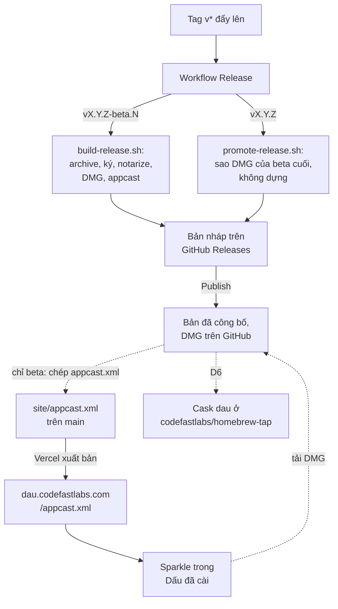
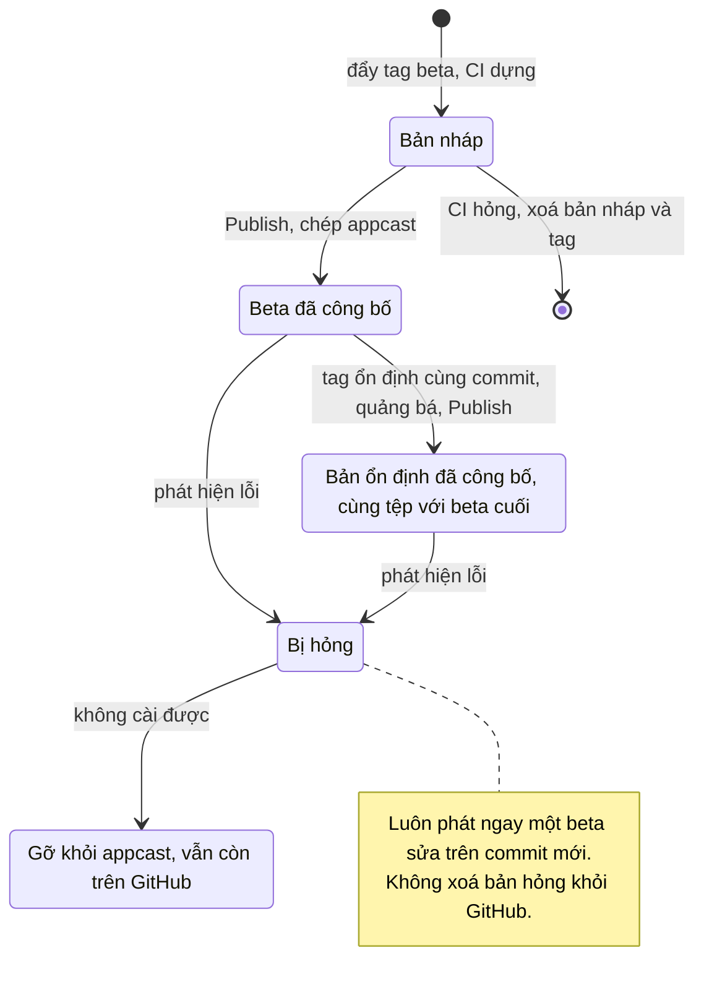
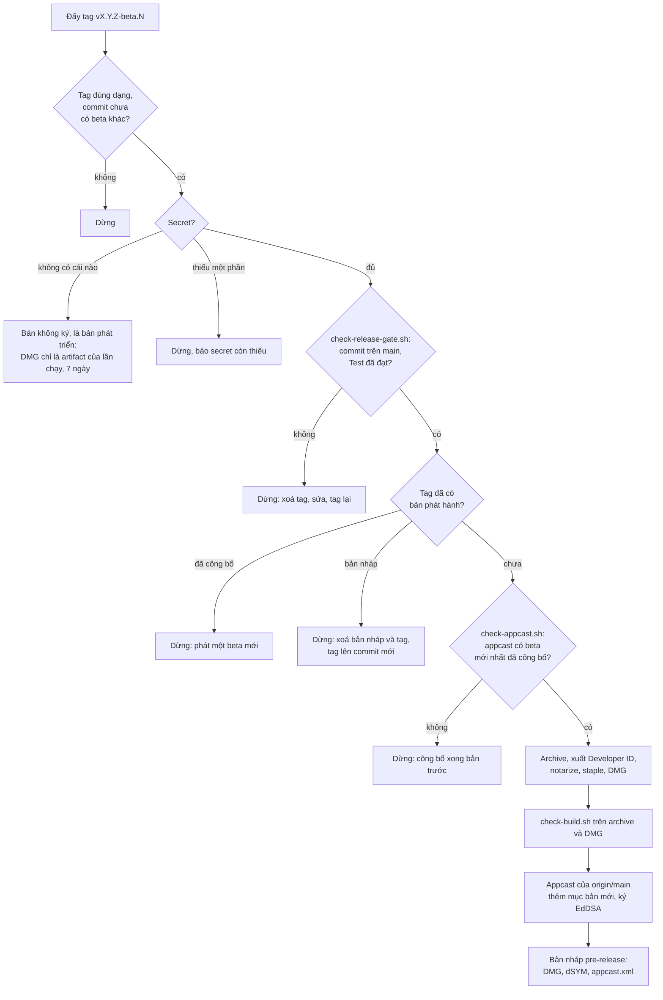
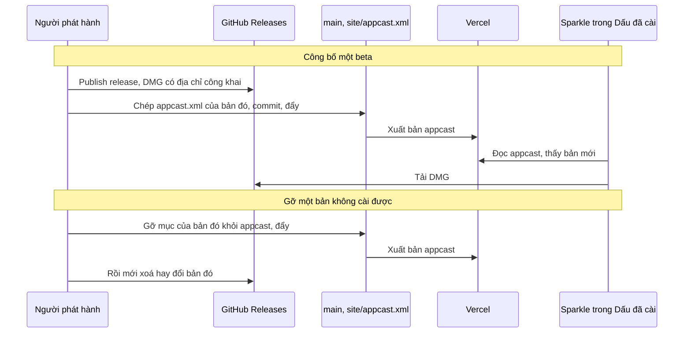

# Phát hành

Cách một bản Dấu ra đời: từ tag git tới DMG, bản cập nhật Sparkle và Homebrew. Quyết định: D6 (Phát hành), D7 (Cập nhật và loại bản dựng), D25 (Nhận diện). Kế hoạch mốc: [`docs/Progress.md`](Progress.md) mục "Kế hoạch M7".



Phiên chính và subagent không cầm khoá: chứng chỉ, khoá App Store Connect và khoá EdDSA chỉ nằm ở máy người dùng và trong secret của GitHub. Mọi thứ trong repo là mã, mẫu cấu hình và tên secret.

## Thành phần

| Thành phần | Ở đâu |
|---|---|
| Script dựng một bản beta (archive, xuất Developer ID, notarize, staple, DMG, appcast) | `scripts/release/build-release.sh` |
| Script quảng bá beta cuối thành bản ổn định (sao tài sản, không dựng) | `scripts/release/promote-release.sh` |
| Kiểm một bản build (biểu tượng, ký hiệu, khoá Sparkle, bộ gõ, chữ ký) | `scripts/release/check-build.sh` |
| Kiểm điều kiện của một tag: commit nằm trong `origin/main`, workflow Test đã đạt (dùng chung cho dựng và quảng bá) | `scripts/release/check-release-gate.sh` |
| Kiểm appcast nền có mục của beta mới nhất đã công bố | `scripts/release/check-appcast.sh` |
| Sắp xếp cửa sổ DMG bằng Finder (chỉ CI) | `scripts/release/layout-dmg.sh` |
| Test ở mỗi lần đẩy mã | `.github/workflows/test.yml` |
| Tag `v*`: beta dựng bản nháp, bản ổn định quảng bá beta cuối, trên GitHub Releases | `.github/workflows/release.yml` |
| Appcast, thư mục gốc của project Vercel | `site/appcast.xml` |

Cách gọi và tuỳ chọn của từng script nằm ở đầu script.

## Việc của người dùng (làm một lần)

1. **Apple Developer Program** (99 USD/năm). Đăng ký tổ chức nếu codefastlabs là pháp nhân (cần mã D-U-N-S), để Gatekeeper hiện tên tổ chức (D7). Ghi lại **Team ID** (developer.apple.com › Account › Membership details).
2. **Chứng chỉ Developer ID Application.** Xcode › Settings › Accounts › chọn Team › Manage Certificates › "+" › Developer ID Application. Rồi Keychain Access › login › My Certificates › chuột phải chứng chỉ vừa tạo › Export… › định dạng `.p12`, đặt mật khẩu. File `.p12` để ngoài repo.
3. **Khoá App Store Connect API cho notarize.** App Store Connect › Users and Access › Integrations › App Store Connect API › Team Keys › tạo khoá (vai trò Developer là đủ). Tải `.p8` (chỉ tải được một lần); ghi **Key ID** và **Issuer ID** (hiện đầu trang).
4. **Khoá EdDSA của Sparkle.** Công cụ nằm trong gói Sparkle mà Xcode đã tải. Từ gốc repo:

   ```sh
   xcodegen generate
   xcodebuild -resolvePackageDependencies -project Dau.xcodeproj -scheme Dau -derivedDataPath build/DerivedData-keys
   B=build/DerivedData-keys/SourcePackages/artifacts/sparkle/Sparkle/bin
   $B/generate_keys                      # tạo khoá, cất khoá riêng vào Keychain đăng nhập, in KHOÁ CÔNG KHAI
   $B/generate_keys -x ~/dau-sparkle.key # xuất khoá riêng ra file (ngoài repo)
   ```

   Khoá công khai in ra (chuỗi base64 ngắn) là `DAU_SPARKLE_PUBLIC_KEY`. Nội dung file xuất là `DAU_SPARKLE_PRIVATE_KEY`. Xong thì cất một bản sao ở nơi an toàn (trình quản lý mật khẩu), rồi xoá file xuất: mất khoá riêng thì mọi bản đã cài không cập nhật được nữa, vì chúng chỉ tin chữ ký của đúng khoá này. Dọn `build/DerivedData-keys` sau đó.
5. **Nạp secret vào GitHub** (repo › Settings › Secrets and variables › Actions, hoặc `gh secret set TÊN`). Tên chính xác mà workflow dùng:

   | Secret | Giá trị |
   |---|---|
   | `DAU_TEAM_ID` | Team ID (bước 1) |
   | `DAU_DEVELOPER_ID_P12` | file `.p12` mã base64: `base64 -i file.p12 \| pbcopy` |
   | `DAU_DEVELOPER_ID_P12_PASSWORD` | mật khẩu của `.p12` |
   | `DAU_NOTARY_KEY` | nội dung file `.p8` (cả dòng BEGIN/END) |
   | `DAU_NOTARY_KEY_ID` | Key ID |
   | `DAU_NOTARY_ISSUER_ID` | Issuer ID |
   | `DAU_SPARKLE_PUBLIC_KEY` | khoá công khai (bước 4) |
   | `DAU_SPARKLE_PRIVATE_KEY` | khoá riêng (bước 4) |

   Cấu hình dở dang (có một phần) làm script dừng với tên các secret còn thiếu, không âm thầm ra bản không ký. Chưa có secret nào thì chạy chế độ không ký (dưới).
6. **Vercel.** Nối repo `codefastlabs/dau` với project của `dau.codefastlabs.com`, Root Directory là `site`, không có bước build. Tới M8 thư mục chỉ có `appcast.xml`; kiểm `https://dau.codefastlabs.com/appcast.xml` trả về file đó.
7. **Nền DMG.** Ảnh `Resources/Brand/DmgBackground.png` (640×400 pt, theo artboard "Cửa sổ ảnh đĩa DMG" trong `docs/canvas/src/DmgWindow.dc.html`) và tuỳ chọn `DmgBackground@2x.png` (1280×800, cho màn hình Retina). Script ghép hai file thành một TIFF. Thiếu `DmgBackground.png` thì DMG không có nền.

## Phát hành một tag

Hai đường theo tag; mọi tag bắt đầu bằng `v` và theo dạng dưới đây, dạng khác bị từ chối.

| Tag | Số hiển thị (`CFBundleShortVersionString`) | Workflow làm gì |
|---|---|---|
| `v0.1.0-beta.1` | 0.1.0 | dựng một bản beta (đường beta, dưới) |
| `v0.1.0-beta.2` | 0.1.0 | dựng một bản beta, trên commit mới |
| `v0.1.0` | 0.1.0 (cùng tệp với beta cuối) | quảng bá beta cuối, không dựng (đường ổn định, dưới) |

Số hiển thị luôn là ba số nguyên `X.Y.Z`, chữ "beta N" chỉ nằm ngoài tệp nhị phân: tên tag, tiêu đề bản phát hành trên GitHub (D7). Bản phát triển dựng bằng `scripts/dev/install-app.sh` mang số `X.Y.Z` của tag `v*` gần nhất trên HEAD (không có tag thì số trong `project.yml`; build bằng Xcode giữ `project.yml`).

Vòng đời của một bản, từ tag tới lúc thôi phát:



**Điều kiện chung** (`scripts/release/check-release-gate.sh`, chạy được trên máy): workflow chỉ dựng bản ký hay quảng bá khi commit được tag nằm trong `origin/main` và workflow Test đã đạt trên đúng commit đó; thiếu một trong hai thì dừng và báo lý do. Tag lên commit chưa lên `main` hay chưa xanh thì xoá tag, sửa, rồi tag lại.

### Đường beta

Các điểm kiểm trước khi dựng, theo thứ tự `scripts/release/build-release.sh` chạy chúng:



1. Chắc chắn `main` xanh (workflow Test) và đã commit mọi thứ của bản này.
2. Tag và đẩy tag. Với hai bản thử của kế hoạch M7 bước 2, việc này công bố chúng lên appcast, nên cần người dùng đồng ý trước khi đẩy tag.

   ```sh
   git tag v0.1.0-beta.1
   git push origin v0.1.0-beta.1
   ```

   Mỗi beta cần một commit mới: script từ chối tag beta lên commit đã có tag beta khác, vì cùng commit thì cùng số build.

   **Tag đã công bố không bao giờ được dựng lại:** bản ký từ chối tag đã có bản phát hành không phải bản nháp. Nếu CI hỏng trước khi công bố thì xoá bản nháp (và tag) trên GitHub rồi tag lên một commit mới; tag còn bản nháp cũng bị từ chối, để không dựng đè.
3. Workflow Release dựng bản ký, rồi tạo **bản nháp** pre-release trên GitHub Releases (tiêu đề "Dấu 0.1.0 beta 1") kèm DMG, dSYM và `appcast.xml`: appcast của `origin/main` (không phải file ở commit được tag, vì mục của bản trước chỉ vào file đó ở bước Công bố) cộng mục của bản mới. Bản ký từ chối dựng nếu appcast đó thiếu beta mới nhất đã công bố trên GitHub (`check-appcast.sh`): phải công bố xong bản trước (bước 5) rồi mới tag bản sau. Chưa có gì được công bố: người dùng chưa thấy gì. Thiếu secret thì workflow dựng bản không ký (dưới) và chỉ lưu DMG thành artifact của lần chạy (7 ngày), không tạo bản nháp.
4. Kiểm bản nháp: log của workflow in từng bước đã làm hay bỏ qua, và `summary.txt`. Thử mở DMG đã tải về.
5. **Công bố** (người dùng đồng ý một lần cho bản thử đầu, theo kế hoạch M7 bước 4): bấm Publish release trên GitHub; chép `appcast.xml` từ tài sản của bản đó vào `site/appcast.xml`, commit, đẩy lên `main` để Vercel xuất bản. Làm theo thứ tự này: nếu appcast lên trước, Sparkle trỏ vào địa chỉ DMG chưa có. Cask Homebrew ở `codefastlabs/homebrew-tap`: theo D6 (Phát hành).

### Đường ổn định (quảng bá beta cuối)

Bản ổn định là tệp nhị phân của bản beta cuối, giữ nguyên, không dựng lại (như bản ứng viên của Apple): cùng DMG, chữ ký, vé notarize và `CFBundleVersion`. Muốn sửa gì sau beta cuối thì phát thêm một beta, không sửa rồi tag bản ổn định.

1. Beta cuối đã công bố (bước 5 ở trên): item của nó đã nằm trong `site/appcast.xml` cho mọi người, nên bản ổn định **không thêm item** vào appcast (cùng `sparkle:version`). Khi có kênh Beta (sau bản thử đầu, D7) thì đổi kênh của item; chưa làm.
2. Tag **đúng commit của tag beta cuối** rồi đẩy tag:

   ```sh
   git tag v0.1.0 v0.1.0-beta.2
   git push origin v0.1.0
   ```

   Workflow Release chạy `scripts/release/promote-release.sh`: tìm tag `v0.1.0-beta.N` cùng commit (N lớn nhất), tải DMG và dSYM của bản phát hành đó, đổi tên thành `Dau-0.1.0.dmg` và `Dau-0.1.0.dSYMs.zip` (đổi tên không đổi chữ ký hay vé notarize: cả hai nằm trên nội dung DMG; script kiểm lại bằng `codesign`, `stapler validate`, `spctl` và số hiển thị của Dau.app trong DMG), rồi tạo **bản nháp** không pre-release. Script từ chối khi tag không trỏ vào commit của tag beta nào, khi beta chưa công bố, hay khi đã có bản phát hành cùng tag. Chạy thử trên máy mà không tạo gì: `scripts/release/promote-release.sh --tag v0.1.0 --dry-run`.
3. **Công bố:** bấm Publish release trên GitHub. Không đụng `site/appcast.xml`. Cask Homebrew ở `codefastlabs/homebrew-tap`: theo D6 (Phát hành).

**Số build.** `CFBundleVersion` mặc định là mười lần số commit của HEAD (`git rev-list --count`), nên tăng theo lịch sử; mỗi bản dựng một số, và số này cùng commit trong ngoặc phân biệt các beta của một phiên bản (chúng cùng số hiển thị). Bản ổn định không có số riêng: nó mang số của beta cuối. Cờ `--build-number` của script đặt số khác khi cần. Vì vậy `main` đã push không bao giờ bị viết lại (force push, rebase): lịch sử ngắn lại thì số build lùi.

### Thứ tự công bố và gỡ

Sơ đồ cho luật thứ tự ở bước 5 của đường beta và bước 3 của mục "Khi một bản bị hỏng": appcast chỉ trỏ vào DMG đã có địa chỉ công khai trên GitHub.



## Khi một bản bị hỏng

Chỉ có một kênh (D7): mọi người nhận bản mới nhất trong appcast.

1. **Phát ngay một beta sửa** (đường beta, trên commit mới). Số build cao hơn nên Sparkle đẩy nó tới mọi người, kể cả người đã cài bản hỏng.
2. **Không xoá bản hỏng khỏi GitHub:** mục appcast của nó trỏ vào DMG ở đó, và máy đã tải appcast cũ vẫn cần địa chỉ ấy.
3. **Chỉ gỡ mục của bản hỏng khỏi appcast khi nó không cài được** (người dùng không cập nhật qua nó được). Gỡ khỏi `site/appcast.xml` trước, đợi Vercel xuất bản, rồi mới xoá hay đổi gì trên GitHub; làm ngược lại thì appcast trỏ vào địa chỉ không còn.
4. Quay về bản trước (D19) để sau bản thử đầu.

## Chế độ không ký

Khi không có secret nào (hoặc `--unsigned`), script vẫn chạy trọn từ archive tới DMG và báo bước nào bị bỏ qua: xuất Developer ID, notarize, staple, ký DMG, ký bản cập nhật, appcast. Bản này dựng như bản phát triển (D7, D25), dùng để kiểm quy trình, không phát cho người dùng:

- `DAU_OFFICIAL=NO`: biểu tượng bản phát triển, không có `SUFeedURL` và `SUPublicEDKey`, nên Sparkle không khởi động;
- app ký tạm (ad hoc), không có Team ID nên App Group bị từ chối (D24);
- DMG tên `Dau-<phiên bản>-dev-unsigned.dmg` (không có tag: `Dau-dev-unsigned.dmg`), không có appcast.

Chạy trên máy phát triển, không cần chứng chỉ (khoảng một phút, ghi vào `build/release/`):

```sh
scripts/release/build-release.sh --tag v0.1.0-beta.1 --unsigned
```

Không cờ `--layout` thì không mở Finder: DMG có Dau.app và liên kết Applications nhưng cửa sổ dùng bố cục mặc định, không nền.

## Bố cục cửa sổ DMG

Bố cục (kích thước cửa sổ, vị trí biểu tượng, nền) nằm trong `.DS_Store` của ảnh đĩa, do Finder ghi; macOS không có API công khai khác. `--layout` gọi `scripts/release/layout-dmg.sh`, dùng AppleScript điều khiển Finder vài giây và hiện một cửa sổ Finder, nên chỉ chạy trên CI (workflow Release đã bật) hoặc khi người dùng đồng ý giờ chạy. Nếu bước này lỗi, script cảnh báo và vẫn ra DMG không có bố cục: đọc dòng "Bố cục cửa sổ DMG" ở `summary.txt`.

## Kiểm bản build

`scripts/release/check-build.sh` chạy trong script phát hành trên cả bản trong archive lẫn bản trong DMG đã mở. Bản chính thức (`--signed`): `CFBundleIconName` của Dấu.app và bộ gõ là `AppIcon` (D25), `SUFeedURL` và `SUPublicEDKey` có ở app chủ. Bản không ký: `AppIconDev`, không có hai khoá đó. Ở cả hai: hai binary universal và đã lược ký hiệu cục bộ (`nm`), dSYM của cả hai có trong archive, bộ gõ không có khoá `SU…`, `SUEnableSystemProfiling` là false (D8), bộ gõ không link Sparkle và không có quyền mạng (N2). Bản ký còn được kiểm bằng `codesign`, `spctl` và `stapler validate`.

## Còn phải thấy chạy thật

Phần ký, notarize, staple, `layout-dmg.sh` và `generate_appcast` ký thật cần tài khoản hoặc Finder nên chưa chạy ở máy phát triển; chế độ không ký đã chạy trọn tới DMG. Lần thấy chúng chạy đầu tiên là bước 2 của kế hoạch M7 (hai tag thử sau bước 0): sửa script theo log của lần đó.

Đường quảng bá (`promote-release.sh`) cũng chưa chạy thật: cần một bản beta đã công bố trên GitHub (bước 2 của kế hoạch M7) để `gh release download`, kiểm `codesign` / `stapler` / `spctl` trên tệp đã đổi tên và tạo bản nháp. Lần thấy nó chạy đầu tiên là lúc quảng bá beta cuối của 0.1.0: chạy `--dry-run` trước, và sửa script hay tài liệu này theo log. Việc đổi tên DMG không làm hỏng chữ ký hay vé notarize là suy từ cách hai thứ này gắn vào nội dung tệp; `--dry-run` là lần kiểm thật.

Các kiểm điều kiện (`check-release-gate.sh`, `check-appcast.sh`, từ chối tag đã có bản phát hành) cũng chưa chạy trên CI với bản ký thật: phần đọc kết quả workflow Test và danh sách bản phát hành bằng `gh` cần quyền `actions: read` và `GH_TOKEN` của workflow; lần chạy đầu của bước 2 (M7) là lần kiểm thật.
